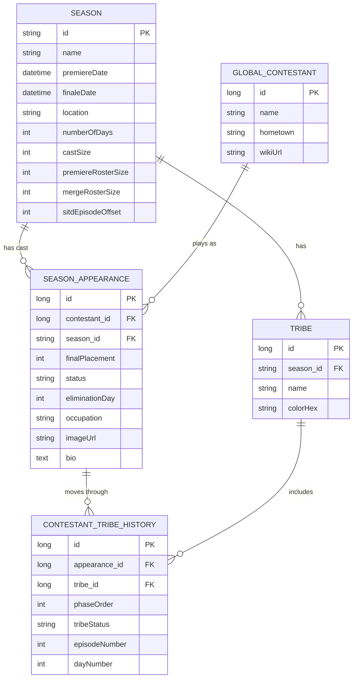

# Unreality League

A reality TV fantasy league platform, starting with Survivor. Live at [unrealityleague.com](https://unrealityleague.com).

## Features (Vertical Slice 1)

- **Season directory:** each season with its location, length, cast size, and tribe colors.
- **Contestant performance across a season:** every castaway's final placement, status (winner, finalist, jury, or pre-jury), and elimination day. Castaways in a season that is still airing show as active.
- **Tribe progression:** each castaway's tribe history by day and episode, from starting tribe through swaps to the merge.
- **Linked profiles for returning players:** one identity per person, with a separate profile for each season they played (photo, occupation, bio, result) and links between those seasons.

## Tech Stack

- **Frontend:** Angular 21 (standalone components, signals), TypeScript 5.9. Deployed on Cloudflare Pages.
- **Backend:** Java 21, Spring Boot 4.1 (Spring Web MVC, Spring Data JPA), Lombok, Maven. Deployed on Railway.
- **Database:** PostgreSQL, hosted on Railway.

## Project Structure

```
survivor-backend/                      Spring Boot REST API
  src/main/java/com/survivor/backend/
    controllers/                       REST endpoints
    services/                          Business logic and entity-to-DTO mapping
    repositories/                      Spring Data JPA repositories
    models/                            JPA entities
    dtos/                              API response shapes
survivor-frontend/                     Angular single-page app
  src/app/features/roster/
    components/                        Season picker, season roster, castaway card and detail page,
                                       status badge, tribe flag
    services/                          HTTP client for the API
    models/                            TypeScript interfaces for API responses
    utils/                             Bio parsing, tribe color gradients
  src/environments/                    API base URL for development and production builds
```

The API is read-only. All endpoints are `GET` requests under `/api/v1/public`:

| Endpoint | Returns |
|---|---|
| `/seasons` | All seasons |
| `/seasons/{seasonId}` | One season |
| `/seasons/{seasonId}/contestants` | A season's cast, ordered by final placement |
| `/contestants/{appearanceId}` | One castaway's profile for one season, with tribe history and bio |
| `/contestants/{contestantId}/appearanceHistory` | Every season a person has played |

## Data Model

A real person is stored once as a `GlobalContestant` (name, hometown, wiki link). Each time they play, a `SeasonAppearance` links them to a `Season` and holds everything that belongs to that season: placement, status, elimination day, photo, occupation, and bio. That split is what gives a returning player a separate profile per season while keeping one shared identity. Survivor's teams are tribes: each `Season` has its `Tribe`s, and `ContestantTribeHistory` records which tribe an appearance belonged to at each phase (starting tribe, swap, merge), with the day and episode. Fantasy league teams are not modeled yet (see Roadmap).



## Roadmap

| Slice | Scope | Status |
|---|---|---|
| 1. Season database | Seasons, castaways, per-season profiles, and tribe history, with public season, roster, and castaway pages | **Complete** |
| 2. Accounts | Sign-up and login with Spring Security and JWT, plus Angular sign-in views | **In progress** |
| 3. Leagues and draft | Create and join leagues with invite codes, and draft four castaways before the premiere, with roster validation | Planned |
| 4. Scoring and live leaderboard | Record episode results from the Survivor wiki into a scoring ledger and rank each league by total points | Planned |
| 5. Mid-season play | A merge pick, "Shot in the Dark" wagers on the winner, and scheduled email alerts | Planned |

## Running Locally

### Prerequisites

- JDK 21
- PostgreSQL
- Node.js and npm (TODO: document the minimum Node.js version; it is not pinned in the repo)

### Backend

Set these environment variables, then start the API from `survivor-backend/`:

| Variable | Required | Purpose |
|---|---|---|
| `DB_PASSWORD` | Yes | PostgreSQL password |
| `DB_URL` | No | JDBC connection URL. Defaults to a local PostgreSQL database. |
| `DB_USER` | No | PostgreSQL user. Defaults to the local default user. |
| `CORS_ALLOWED_ORIGIN` | No | Frontend origin allowed to call the API. Defaults to the Angular dev server. |

```bash
cd survivor-backend
./mvnw spring-boot:run     # Windows: mvnw.cmd spring-boot:run
```

The API runs on port 8080. On a new database, set up the tables and demo data first by following [docs/DATABASE.md](docs/DATABASE.md). The backend validates against an existing schema and won't start against an empty database.

### Frontend

```bash
cd survivor-frontend
npm install
npm start
```

The app runs at `http://localhost:4200` and calls the local API configured in `src/environments/environment.development.ts`. `npm run build` creates the production build, which uses `src/environments/environment.ts`.
